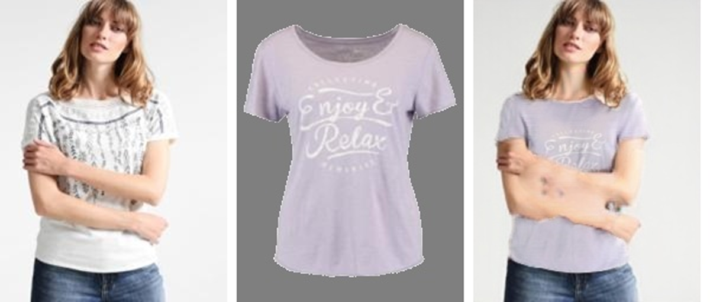
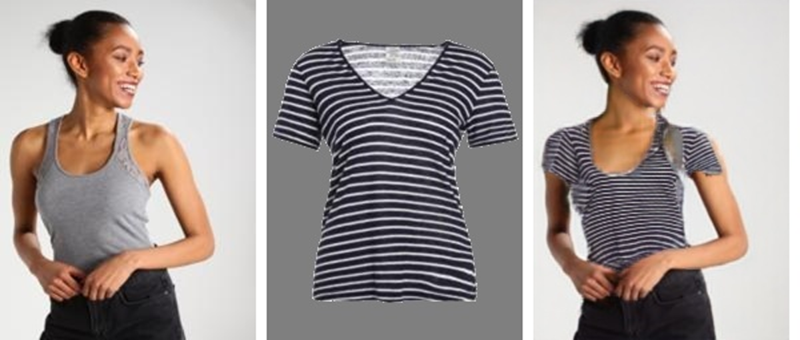

# Virtual Try-On with ACGPN

**CS787 · Generative Artificial Intelligence — course project**

Vineet Nagrale (231158) · Jaiveer Sabharwal (230495) · Ayush Singh Sanjay Kumar (231010) · Dishank Kumawat (230377) · Prateek Raj (230079)

Given a photo of a person and a photo of a garment, the model generates a new, realistic photo of that person wearing that garment. This repository implements the **ACGPN** architecture (*Adaptive Content Generating and Preserving Network*, Yang et al., CVPR 2020) on the VITON benchmark, ported to a current PyTorch stack, with a full evaluation pipeline.




*Each strip: input person · target garment · generated try-on.*

## Results

Measured on all **2,032** VITON test images in reconstruction mode (each person is re-dressed in their own garment, so the real photo serves as ground truth):

| Metric | Ours | Reported for ACGPN |
|---|---|---|
| SSIM ↑ (similarity to the real photo) | **0.862** | 0.866 |
| Inception Score ↑ (realism and variety) | **2.80** | 2.82 |

Both are within about 1% of the published figures.

## Architecture

Four stages, each a separate network:

1. **Semantic layout (G1)**: predicts the new 14-class body-part map, i.e. where arms and the new garment will be. U-Net encoder–decoder trained as a conditional GAN.
2. **Clothes mask (G2)**: predicts the garment's exact silhouette on this body. U-Net + conditional GAN.
3. **Warping (U)**: a Spatial Transformer Network that predicts thin-plate-spline control points and warps the flat garment onto that silhouette, with a second-order smoothness constraint.
4. **Content fusion (G)**: composes the final image, preserving face, hair and lower clothing and generating the torso and arms from the predicted layout, warped garment and skin colour. U-Net + conditional GAN.

Inputs are stacked as channels: 18 pose keypoints become 18 channels (an 11 × 11 square per keypoint), the body-part map becomes 14 one-hot channels, and each generator also receives one random-noise channel. The GAN components follow NVIDIA's pix2pixHD: multi-scale PatchGAN discriminators with a least-squares GAN loss.

Training is self-supervised (each person is reconstructed in their own garment) with L1, VGG-19 perceptual, cross-entropy, adversarial and warp-smoothness losses.

## Differences from the paper

| Aspect | Paper | This implementation |
|---|---|---|
| Optimiser | Adam | AdamW with weight decay |
| Dropout | Random dropout in generators | Removed |
| GAN / VGG loss | On the raw generated image | Real garment region pasted back first |
| Warp sampling | Framework default | Explicit `align_corners=True` |
| Framework | PyTorch 1.x era | PyTorch 2.11, CUDA 12.8, NumPy 2 |
| Evaluation | — | Reconstruction mode (`ACGPN_RECON=1`) and `tools/evaluate.py` |

Porting fixes: removed NumPy aliases (`np.float`, `np.int`), `transforms.Scale` → `transforms.Resize`, and Windows-safe output file names.

## Setup

```bash
python -m venv .venv
# Windows: .venv\Scripts\activate    Linux/macOS: source .venv/bin/activate
pip install torch==2.11.0 torchvision==0.26.0 --index-url https://download.pytorch.org/whl/cu128
pip install -r requirements.txt
```

An NVIDIA GPU is required (the code calls `.cuda()` directly).

### Data

Download the VITON data as rearranged by the ACGPN authors and extract both archives into `Data_preprocessing/`:

- [Training set](https://drive.google.com/file/d/1lHNujZIq6KVeGOOdwnOXVCSR5E7Kv6xv/view?usp=sharing)
- [Test set](https://drive.google.com/file/d/1tE7hcVFm8Td8kRh5iYRBSDFdvZIkbUIR/view?usp=sharing)

Expected layout: `Data_preprocessing/{train,test}_{img,label,edge,color,colormask,mask,pose}/` — 14,221 training and 2,032 test pairs.

Training also needs the ImageNet VGG-19 weights for the perceptual loss:

```bash
curl -L -o ACGPN_train/models/vgg19-dcbb9e9d.pth https://download.pytorch.org/models/vgg19-dcbb9e9d.pth
```

## Usage

**Train** (run from `ACGPN_train/`):

```bash
python train.py --name acgpn --nThreads 0
```

Checkpoints are saved to `ACGPN_train/checkpoints/<name>/`. The paper's schedule trains G1 and U for 20 epochs and G2 and G for 200.

**Inference** (run from `ACGPN_inference/`): put `latest_net_{G,G1,G2,U}.pth` in `ACGPN_inference/checkpoints/label2city/`, then

```bash
python test.py --nThreads 0
```

By default each person is paired with a random test garment. Outputs go to `ACGPN_inference/sample/` as 5-panel strips: body-part map · garment mask · garment · **generated try-on** · original photo.

**Evaluate** (SSIM and Inception Score):

```bash
cd ACGPN_inference
ACGPN_RECON=1 python test.py --nThreads 0 --serial_batches   # each person wears their own garment
cd ..
python tools/evaluate.py ACGPN_inference/sample Data_preprocessing/test_img
```

On Windows PowerShell, set the variable with `$env:ACGPN_RECON = "1"` before running `test.py`.

## Limitations

- Artifacts on arms when the garment shape changes a lot (for example long sleeves to short sleeves).
- Output resolution is limited to 192 × 256.
- Lower clothing is sometimes smudged.

## Credits and license

Based on the official ACGPN code: [switchablenorms/DeepFashion_Try_On](https://github.com/switchablenorms/DeepFashion_Try_On), which builds on [NVIDIA pix2pixHD](https://github.com/NVIDIA/pix2pixHD).

> Han Yang, Ruimao Zhang, Xiaobao Guo, Wei Liu, Wangmeng Zuo, Ping Luo. *Towards Photo-Realistic Virtual Try-On by Adaptively Generating-Preserving Image Content.* CVPR 2020.

VITON dataset: Han et al., *VITON: An Image-based Virtual Try-on Network*, CVPR 2018.

Use of this code is restricted to **non-commercial research and educational purposes**, as in the original repository; files derived from pix2pixHD are under [CC BY-NC-SA 4.0](https://creativecommons.org/licenses/by-nc-sa/4.0/legalcode).
